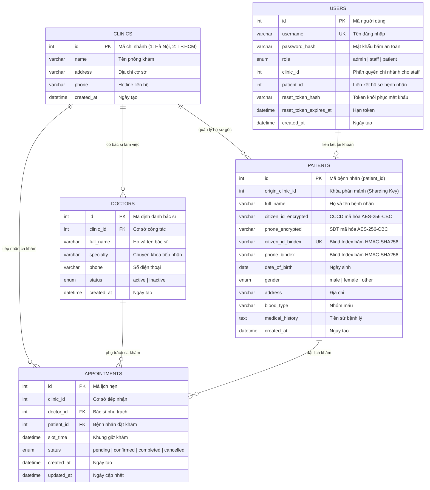

# TÀI LIỆU THIẾT KẾ CƠ SỞ DỮ LIỆU PHÂN MẢNH (DATABASE DESIGN DOCUMENT)
**Dự án:** ClinicCare Distributed System  
**Kiến trúc:** Modular Monolith &bull; MySQL Horizontal Sharding &bull; Clean Architecture  

---

## 1. TỔNG QUAN KIẾN TRÚC PHÂN MẢNH (SHARDING STRATEGY)

Hệ thống quản lý phòng khám đa chi nhánh được phân mảnh ngang (Horizontal Sharding) trên 2 Node CSDL vật lý độc lập:
- **Shard 1 (`clinic_hanoi`):** Lưu trữ toàn bộ dữ liệu nghiệp vụ của Chi nhánh 1 - Hà Nội.
- **Shard 2 (`clinic_hcm`):** Lưu trữ toàn bộ dữ liệu nghiệp vụ của Chi nhánh 2 - TP.HCM.

### Khóa phân mảnh (Sharding Key):
- Bảng `patients`: Sử dụng `origin_clinic_id` (1 hoặc 2) để định tuyến ghi dữ liệu vật lý vào đúng Node cơ sở gốc.
- Bảng `appointments`: Sử dụng `clinic_id` để định tuyến lưu trữ ca khám vào chi nhánh tiếp nhận.
- Tra cứu xuyên Node (Cross-Node Query): Sử dụng `Promise.allSettled` quét đồng thời 2 Node với thời gian phản hồi song song $O(1)$.

---

## 2. SƠ ĐỒ THỰC THỂ MỐI QUAN HỆ (ERD - ENTITY RELATIONSHIP DIAGRAM)

Cấu trúc 5 bảng tại mỗi Node Sharding:



---

## 3. CƠ CHẾ BẢO MẬT DỮ LIỆU CÁ NHÂN (PII PROTECTION)

1. **Mã Hóa Đối Xứng AES-256-CBC:**
   - Trường `citizen_id` và `phone_number` được mã hóa thành `citizen_id_encrypted` và `phone_encrypted`.
   - Mỗi giá trị mã hóa sử dụng một Initialization Vector (IV) ngẫu nhiên 16 bytes. Dữ liệu lưu trong DB có dạng `iv_hex:ciphertext_hex`.
   - Người quản trị CSDL hoặc kẻ tấn công dù dump trực tiếp database cũng không thể đọc được CCCD hay Số điện thoại của bệnh nhân.

2. **Chỉ Mục Tra Cứu Mù (Blind Index bằng HMAC-SHA256):**
   - Vấn đề: Dữ liệu mã hóa AES-256 sinh chuỗi ngẫu nhiên khác nhau mỗi lần mã hóa, không thể đánh chỉ mục $B\text{-Tree}$ để tìm kiếm chính xác `WHERE cccd = ?`.
   - Giải pháp: Băm một chiều CCCD và SĐT kết hợp muối bí mật (`BLIND_INDEX_SECRET`) qua HMAC-SHA256 để tạo chuỗi cố định 64 ký tự lưu vào `citizen_id_bindex` và `phone_bindex`.
   - Đặt `UNIQUE KEY` trên `citizen_id_bindex` cho phép truy vấn $O(\log N)$ cực nhanh mà không làm lộ dữ liệu gốc.

---

## 4. CƠ CHẾ CHỐNG TRÙNG LỊCH 2 LỚP (CONCURRENCY CONTROL)

1. **Lớp 1 (Application Level - Khóa bi quan Pessimistic Locking):**
   - Sử dụng Transaction với mệnh đề `SELECT ... WHERE doctor_id = ? AND slot_time = ? FOR UPDATE`.
   - Ngăn chặn Race Condition khi hàng trăm người dùng bấm đặt cùng 1 bác sĩ trong cùng tích tắc.

2. **Lớp 2 (Database Level - Unique Constraint):**
   - Ràng buộc duy nhất `UNIQUE KEY uq_doctor_slot (doctor_id, slot_time)` tại cấp độ CSDL.
   - Nếu có 2 transaction lọt qua đồng thời, MySQL sẽ ném lỗi mã `ER_DUP_ENTRY` (mã lỗi 1062) và hệ thống tự động bẫy thành phản hồi `409 Conflict`.

---

## 5. HƯỚNG DẪN KHỞI TẠO CSDL CHO NHÓM

### Cách 1: Khởi tạo tự động qua Node.js (Khuyên dùng)
Chỉ cần chạy lệnh sau tại thư mục gốc của dự án:
```bash
npm run db:init
```
*(Script sẽ tự động tạo 2 database `clinic_hanoi`, `clinic_hcm`, sinh 5 bảng, mã hóa PII và nạp sẵn dữ liệu demo).*

### Cách 2: Import thủ công file SQL
Nhập file SQL chuẩn tại:
```
scripts/schema.sql
```
Mở bằng bất kỳ công cụ quản lý MySQL nào (Navicat, DBeaver, phpMyAdmin, HeidiSQL, MySQL Workbench) và bấm Execute.
