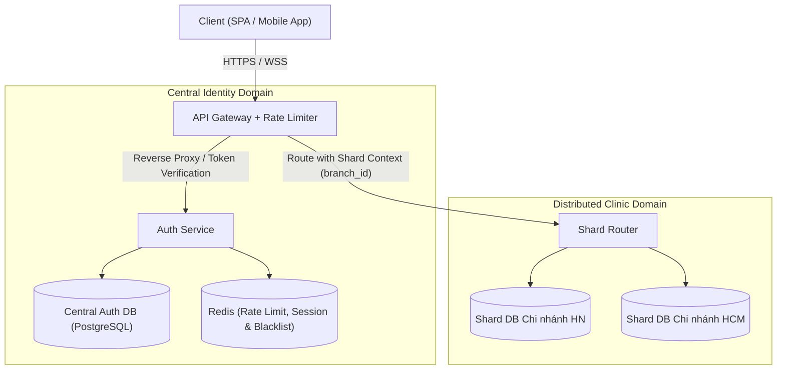
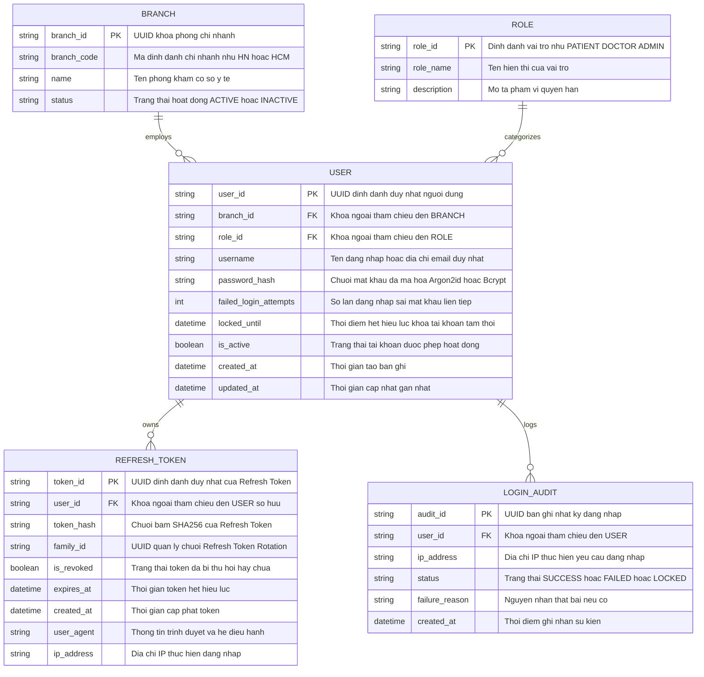

# Tài liệu Thiết kế Kiến trúc & Biểu đồ Tuần tự: Module Xác thực (Auth & RBAC)

> **Dự án:** Hệ thống Đặt lịch Y tế Đa cơ sở (Distributed Clinic Management System)  
> **Căn cứ nghiệp vụ:** [PRD.md](file:///c:/Project/ClinicManagement/PRD.md) & [docs/auth/auth-requirements.md](file:///c:/Project/ClinicManagement/docs/auth/auth-requirements.md)  
> **Người thực hiện:** Software Architect & Database Engineer (`/architect`)  
> **Ngày khởi tạo:** 2026-10-29  

---

## 1. TỔNG QUAN KIẾN TRÚC XÁC THỰC

### 1.1. Phân tích yêu cầu phi chức năng (NFRs)
- **Security (Bảo mật tối cao):** Triệt tiêu rủi ro lộ Token qua XSS bằng cách không lưu Refresh Token trong `localStorage`; chống Brute-force bằng Rate Limiting tại Gateway; kiểm tra mã hóa mật khẩu an toàn (`Argon2id` hoặc `Bcrypt` với cost factor $\ge 12$).
- **Latency (Độ trễ thấp):** Thời gian xác thực Token tại Gateway/Middleware phải $< 30\text{ ms}$ nhờ kiến trúc Stateless JWT (ký số bằng thuật toán bất đối xứng `RS256` hoặc `EdDSA`).
- **Scalability & Consistency:** Tách biệt **Central Auth DB** (lưu Identity, Roles, Permissions tập trung) với **Sharded Branch DBs** (lưu hồ sơ bệnh án, lịch khám theo từng chi nhánh).

### 1.2. Mô hình kiến trúc luồng dữ liệu (Mermaid Flowchart)



---

## 2. THIẾT KẾ CƠ SỞ DỮ LIỆU ĐỊNH DANH (MERMAID ERD)

Dưới đây là sơ đồ thực thể - mối quan hệ (**Entity-Relationship Diagram - ERD**) được thiết kế chuẩn cú pháp Mermaid.js, mô tả cấu trúc dữ liệu phục vụ Authentication, RBAC và quản lý phiên đăng nhập an toàn:



---

## 3. BIỂU ĐỒ TUẦN TỰ: LUỒNG ĐĂNG NHẬP BẢO MẬT (MERMAID SEQUENCE DIAGRAM)

Mô tả chi tiết luồng tương tác giữa **Client**, **API Gateway**, **Auth Service**, **Central Database** và **Redis Cache**, bao gồm cả **Nhánh Thành công (Happy Path)** và **Nhánh Thất bại (Sai mật khẩu / Khóa tài khoản)**:

```mermaid
sequenceDiagram
    autonumber
    actor User as "Người dùng (Bác sĩ / Nhân viên)"
    participant Client as "Frontend Client (SPA / React)"
    participant GW as "API Gateway (Rate Limiter)"
    participant AuthSvc as "Auth Service (Backend)"
    participant Redis as "Redis Cache (Limit & Blacklist)"
    participant DB as "Central Auth DB"

    User->>Client: Nhập Username, Password và bấm "Đăng nhập"
    Client->>GW: POST /api/v1/auth/login { username, password }
    
    %% Tầng Rate Limiting & Brute-Force Check
    GW->>Redis: Kiểm tra IP Rate Limit (Sliding Window: 10 req/phút)
    alt Vượt ngưỡng Rate Limit IP
        Redis-->>GW: IP Limit Exceeded
        GW-->>Client: 429 Too Many Requests { message: "Quá nhiều yêu cầu, vui lòng thử lại sau" }
        Client-->>User: Hiển thị cảnh báo giới hạn tần suất
    else IP hợp lệ
        GW->>AuthSvc: Chuyển tiếp Request đăng nhập
        AuthSvc->>DB: SELECT * FROM USERS WHERE username = ? AND is_active = true
        
        alt Tài khoản không tồn tại
            DB-->>AuthSvc: Trả về null
            AuthSvc->>AuthSvc: Thực hiện dummy hash so sánh (Chống Timing Attack)
            AuthSvc-->>GW: 401 Unauthorized
            GW-->>Client: 401 Unauthorized { message: "Tài khoản hoặc mật khẩu không chính xác" }
            Client-->>User: Báo lỗi thông tin đăng nhập không đúng
            
        else Tìm thấy thông tin tài khoản
            DB-->>AuthSvc: Trả về user record (password_hash, failed_login_attempts, locked_until)
            
            %% Kiểm tra trạng thái khóa tài khoản
            alt Tài khoản đang bị tạm khóa (locked_until > NOW())
                AuthSvc-->>GW: 423 Locked
                GW-->>Client: 423 Locked { message: "Tài khoản đang bị tạm khóa do nhập sai nhiều lần" }
                Client-->>User: Hiển thị thời gian còn lại cần chờ
                
            else Tài khoản sẵn sàng xác thực
                AuthSvc->>AuthSvc: Kiểm tra mật khẩu: verifyPassword(password, password_hash)
                
                %% ================= NHÁNH THẤT BẠI: SAI MẬT KHẨU =================
                alt Mật khẩu KHÔNG hợp lệ (Sai mật khẩu)
                    AuthSvc->>DB: UPDATE USERS SET failed_login_attempts = failed_login_attempts + 1
                    AuthSvc->>DB: INSERT INTO LOGIN_AUDIT (user_id, status, reason) VALUES (?, 'FAILED', 'WRONG_PW')
                    
                    alt failed_login_attempts >= 5
                        AuthSvc->>DB: UPDATE USERS SET locked_until = NOW() + INTERVAL '15 MINUTE'
                        AuthSvc-->>GW: 423 Locked
                        GW-->>Client: 423 Locked { message: "Tài khoản đã bị tạm khóa 15 phút do nhập sai 5 lần" }
                        Client-->>User: Hiển thị thông báo tài khoản bị khóa tạm thời
                    else failed_login_attempts < 5
                        AuthSvc-->>GW: 401 Unauthorized
                        GW-->>Client: 401 Unauthorized { message: "Tài khoản hoặc mật khẩu không chính xác", remaining_attempts: 5 - failed_attempts }
                        Client-->>User: Báo lỗi sai mật khẩu kèm số lần thử còn lại
                    end
                    
                %% ================= NHÁNH THÀNH CÔNG =================
                else Mật khẩu HỢP LỆ
                    AuthSvc->>DB: UPDATE USERS SET failed_login_attempts = 0, locked_until = NULL
                    
                    %% Sinh JWT Token đôi
                    AuthSvc->>AuthSvc: Sinh Access Token (JWT, TTL 15m, signed with RS256/Private Key)<br/>Payload: { sub: user_id, role, branch_id, jti }
                    AuthSvc->>AuthSvc: Sinh Refresh Token (Opaque/Cryptographic Token, TTL 7d, family_id)
                    
                    %% Lưu Refresh Token vào Database & Cache để kiểm soát phiên
                    AuthSvc->>DB: INSERT INTO REFRESH_TOKEN (user_id, token_hash, family_id, expires_at)
                    AuthSvc->>Redis: SET session:{user_id}:{token_id} (TTL 7d)
                    AuthSvc->>DB: INSERT INTO LOGIN_AUDIT (user_id, status) VALUES (?, 'SUCCESS')
                    
                    %% Phản hồi an toàn về Client
                    AuthSvc-->>GW: 200 OK + Payload + Set-Cookie Header
                    GW-->>Client: 200 OK<br/>Set-Cookie: refresh_token=...; HttpOnly; Secure; SameSite=Strict; Path=/api/v1/auth<br/>Body: { access_token, expires_in: 900, user: { user_id, role, branch_id, name } }
                    
                    %% Client xử lý Token
                    Client->>Client: Lưu access_token vào In-Memory State (Zustand/Redux/React Context)
                    Note over Client: Trình duyệt tự động lưu refresh_token vào Cookie bảo mật (JS không đọc được)
                    Client-->>User: Chuyển hướng đến Dashboard theo Role và Branch
                end
            end
        end
    end
```

---

## 4. THIẾT KẾ PHÂN MẢNH SHARDING ĐA CƠ SỞ (SHARD RESOLVER)

### 4.1. Định vị Auth Service trong kiến trúc Sharding
Trong hệ thống y tế đa cơ sở, việc đặt lịch và hồ sơ bệnh án được phân mảnh (Sharded) theo cơ sở y tế để tối ưu tải I/O và độc lập dữ liệu. Tuy nhiên, **Dịch vụ Định danh & Phân quyền (Auth Service) bắt buộc phải là Centralized Service**:
- Toàn bộ tài khoản người dùng, vai trò (`Role`) và ánh xạ chi nhánh (`Branch`) nằm tại **Central Auth Database**.
- Khi đăng nhập thành công, `branch_id` được đóng gói trực tiếp vào **Claims** của `Access Token`:
  ```json
  {
    "sub": "u_9b1deb4d-3b7d-4bad-9bdd-2b0d7b3dcb6d",
    "username": "bacsi.nguyenvana",
    "role": "ROLE_DOCTOR",
    "branch_id": "branch_hn_01",
    "iat": 1730160000,
    "exp": 1730160900
  }
  ```

### 4.2. Cơ chế Shard Router Resolver tại API Gateway / Backend Service
Khi Client gửi các request nghiệp vụ tiếp theo (ví dụ: tạo hồ sơ bệnh án, duyệt lịch khám), Gateway hoặc Service Middleware sẽ giải mã token để định tuyến đúng Shard Database:

```typescript
// ShardResolverMiddleware.ts
import { Request, Response, NextFunction } from 'express';
import { DataSource } from 'typeorm';
import { ShardConnectionPool } from '../config/ShardConnectionPool';

export interface AuthenticatedUserPayload {
  sub: string;
  role: string;
  branch_id: string;
}

export interface ShardedRequest extends Request {
  user?: AuthenticatedUserPayload;
  shardDb?: DataSource;
}

export const shardResolverMiddleware = async (
  req: ShardedRequest,
  res: Response,
  next: NextFunction
) => {
  try {
    // 1. Kiểm tra User context từ JWT Verification Middleware trước đó
    const user = req.user;
    if (!user || !user.branch_id) {
      return res.status(401).json({ error: 'Unauthorized: Thiếu thông tin phân mảnh chi nhánh' });
    }

    // 2. Kiểm tra nếu request có tham số override chi nhánh (dành cho Admin / Khám chéo)
    const targetBranchId = (req.headers['x-target-branch-id'] as string) || user.branch_id;

    // 3. Kiểm soát quyền truy cập chéo chi nhánh (Cross-branch Authorization)
    if (targetBranchId !== user.branch_id && user.role !== 'ROLE_ADMIN') {
      // Bác sĩ chỉ được truy cập chi nhánh khác nếu có phiếu điều phối hợp lệ
      const hasDelegatedAccess = await checkDelegatedAccess(user.sub, targetBranchId);
      if (!hasDelegatedAccess) {
        return res.status(403).json({
          error: 'Forbidden: Bạn không có quyền thao tác trên cơ sở dữ liệu chi nhánh này'
        });
      }
    }

    // 4. Lấy Database Connection Pool tương ứng với Shard Key
    const connection = ShardConnectionPool.getConnection(targetBranchId);
    if (!connection || !connection.isInitialized) {
      return res.status(503).json({
        error: `Database của chi nhánh [${targetBranchId}] tạm thời không sẵn sàng`
      });
    }

    // 5. Gắn connection vào request context để Service / Repository sử dụng
    req.shardDb = connection;
    next();
  } catch (error) {
    return res.status(500).json({ error: 'Lỗi định tuyến cơ sở dữ liệu phân mảnh' });
  }
};
```

### 4.3. Biện pháp triệt tiêu rủi ro bảo mật
1. **Timing Attack Protection:** Khi người dùng nhập username không tồn tại trong hệ thống, hàm kiểm tra vẫn chạy phép tính hash giả lập (dummy hash) với thời gian tương đương `verifyPassword` thực tế để kẻ tấn công không thể dựa vào thời gian phản hồi (Response Latency) nhằm đoán biết tài khoản có tồn tại hay không.
2. **Refresh Token Rotation (RTR):** Mỗi lần gọi `/api/v1/auth/refresh`, hệ thống sẽ hủy Refresh Token hiện tại và sinh ra một cặp Token hoàn toàn mới. Nếu một Refresh Token đã thu hồi bị gửi lại (dấu hiệu kẻ gian đánh cắp token cũ), hệ thống sẽ lập tức kích hoạt cơ chế phòng vệ tự động: vô hiệu hóa toàn bộ `family_id` (buộc mọi phiên đăng nhập của người dùng đó phải đăng xuất ngay lập tức).
