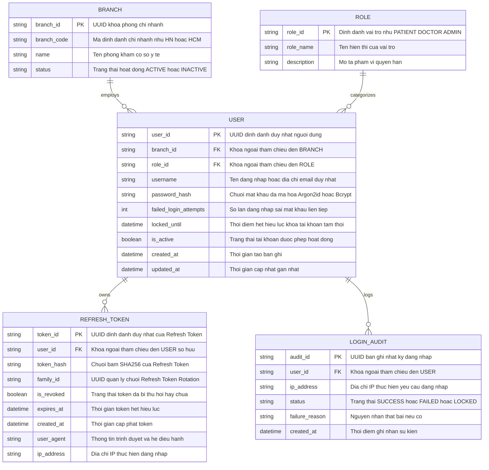

# Tài liệu Yêu cầu Kỹ thuật & Nghiệp vụ: Xác thực và Phân quyền (Auth & RBAC)

> **Dự án:** Hệ thống Đặt lịch Y tế Đa cơ sở (Distributed Clinic Management System)  
> **Căn cứ tài liệu:** `PRD.md` (Epic 1: Quản lý Xác thực và Phân quyền & Phần 2: Rủi ro Bảo mật)  
> **Người thực hiện:** Senior Business Analyst & Edge-Case Finder (`/ba_pm`)  
> **Ngày khởi tạo:** 2026-10-29  

---

## 1. ĐÁNH GIÁ & CÂU HỎI PHẢN BIỆN (CRITICAL QUESTIONS)

### 1.1. Tóm tắt hiểu biết nghiệp vụ
Hệ thống y tế đa cơ sở cần giải quyết bài toán định danh và phân quyền cho 3 nhóm vai trò: **Bệnh nhân (Patient)**, **Bác sĩ (Doctor)**, và **Lễ tân / Quản trị viên (Receptionist/Admin)**. Trọng tâm của hệ thống phân tán là: quyền hạn không chỉ phụ thuộc vào `Role` mà còn gắn liền với `Branch/Node` (Chi nhánh công tác). Nếu không xử lý chặt chẽ ở tầng phiên (Session) và Token, hệ thống sẽ gặp rủi ro rò rỉ dữ liệu y tế nhạy cảm (PII/EMR) hoặc gây gián đoạn trải nghiệm của nhân viên y tế (bị mất dữ liệu khi đang ghi chép bệnh án dài).

### 1.2. Các giả định cần xác thực (Assumptions)
1. **Kiến trúc xác thực:** Sử dụng cơ chế **JWT (JSON Web Token)** kết hợp cặp `Access Token` (thời hạn ngắn) và `Refresh Token` (thời hạn dài) để hỗ trợ xác thực stateless giữa các Node chi nhánh.
2. **Phạm vi chi nhánh của Bác sĩ:** Mỗi bác sĩ có một chi nhánh gốc (Home Branch), nhưng thực tế có thể được điều động tăng cường khám chéo chi nhánh theo ca trực.
3. **Môi trường thiết bị:** Bác sĩ và lễ tân thường dùng chung máy tính tại phòng khám chuyên khoa, trong khi bệnh nhân dùng trình duyệt cá nhân hoặc Mobile App.

### 1.3. Danh sách câu hỏi phản biện trọng yếu
1. **Kiến trúc Auth tập trung hay phân tán khi rớt mạng?**  
   *Nếu đường truyền Internet giữa Chi nhánh A và Server trung tâm bị đứt, Lễ tân và Bác sĩ tại Chi nhánh A có thể đăng nhập để tiếp tục tiếp đón bệnh nhân cục bộ được không? Cần cơ chế Local Auth Cache hay hoàn toàn dựa vào Centralized IdP?*
2. **Bác sĩ di chuyển đa cơ sở (Multi-branch Doctor)?**  
   *Một Bác sĩ có thể trực thứ 2 tại Cơ sở Hà Nội và thứ 5 tại Cơ sở TP.HCM hay không? Quyền hạn truy cập dữ liệu của bác sĩ đó sẽ được kích hoạt theo danh tính cố định hay theo lịch phân ca (Schedule-based Access Control)?*
3. **Cơ chế chống mất dữ liệu khi hết hạn Token (Session Expiration UX)?**  
   *Bác sĩ gõ bệnh án 30 phút, bấm "Lưu" thì Token hết hạn dẫn đến lỗi 401 và mất toàn bộ nội dung. Cần áp dụng cơ chế Silent Refresh Token ngầm (Background Refresh) kết hợp với Modal xác thực tại chỗ (In-place Re-authentication Modal) mà không làm tải lại trang.*
4. **Xử lý thu hồi quyền tức thì (Immediate Revocation)?**  
   *Nếu một nhân viên bị chấm dứt hợp đồng ngay trong ngày hoặc bị phát hiện hành vi gian lận, làm thế nào để vô hiệu hóa ngay lập tức Access Token đang lưu ở client khi JWT vốn mang bản chất stateless?*
5. **Chính sách đăng nhập đồng thời (Concurrent Sessions) trên thiết bị dùng chung?**  
   *Tại phòng khám, một tài khoản Bác sĩ có được phép đăng nhập đồng thời trên nhiều máy tính ở các phòng khám khác nhau cùng lúc không? Khi Bác sĩ ca sau vào làm việc, cơ chế cảnh báo hoặc tự động đăng xuất phiên cũ (Idle Timeout) được kích hoạt sau bao nhiêu phút không thao tác?*

---

## 2. BẢNG PHÂN TÍCH RỦI RO & EDGE CASES

| Nhóm rủi ro | Kịch bản Edge Case | Hậu quả tiềm ẩn | Đề xuất giải pháp nghiệp vụ & kỹ thuật |
| :--- | :--- | :--- | :--- |
| **Bảo mật (OWASP A07 - Token Leakage)** | Lưu trữ JWT trong `localStorage` của trình duyệt; máy tính phòng khám bị nhiễm mã độc hoặc bị dính lỗi XSS. | Token bị đánh cắp, kẻ gian giả mạo bác sĩ truy cập toàn bộ hồ sơ bệnh án phân tán. | **Tuyệt đối không lưu Token trong localStorage**. Bắt buộc lưu `Refresh Token` trong **HttpOnly, Secure, SameSite=Strict Cookie**; `Access Token` chỉ lưu trong bộ nhớ tạm (In-memory state). |
| **Bảo mật (OWASP A01 - Broken Access Control / BOLA)** | Bác sĩ Cơ sở A sửa ID trên payload/URL để cập nhật cấu hình hoặc duyệt lịch khám của Cơ sở B. | Xâm phạm dữ liệu chéo chi nhánh, phá vỡ tính toàn vẹn dữ liệu sharding. | Triển khai **ABAC/RBAC đa tầng** (kiểm tra `user.branch_id == target.branch_id` hoặc có cờ `cross_branch_authorized` cấp bởi Admin). |
| **Bảo mật (OWASP A07 - Session Expiration)** | Bác sĩ đang nhập hồ sơ bệnh án chi tiết (20 phút), Access Token hết hạn. Khi bấm "Lưu", API trả về `401 Unauthorized`. | Trình duyệt redirect về trang Login, **bác sĩ mất toàn bộ dữ liệu khám bệnh vừa nhập**, ức chế và làm chậm tiến độ khám. | **1.** Frontend tự động Silent Refresh trước khi token hết hạn 1 phút.<br>**2.** Nếu Refresh Token thất bại, hiển thị **Modal xác thực tại chỗ (In-place Login Dialog)** để nhập mật khẩu/OTP và gửi lại đúng payload đang dở dang. |
| **Bảo mật (OWASP A07 - Zombie Session)** | Tài khoản bác sĩ bị khóa hoặc đổi quyền, nhưng Access Token cũ vẫn còn hiệu lực trong 15-30 phút. | Bác sĩ bị đình chỉ vẫn có thể xem và tải dữ liệu bệnh án nhạy cảm. | Sử dụng **Token Blacklist (Redis cache)** hoặc kiểm tra `token_version` / `updated_at` của người dùng ở mỗi request nhạy cảm. |
| **Bảo mật (OWASP A07 - Brute Force)** | Kẻ tấn công dùng bot quét mật khẩu tự động vào tài khoản Bác sĩ / Lễ tân. | Bị dò ra mật khẩu quản trị, nguy cơ từ chối dịch vụ (DoS). | **Rate Limiting:** Khóa tạm thời 15 phút nếu nhập sai quá 5 lần liên tiếp; tích hợp reCAPTCHA v3 sau 3 lần sai. |
| **Nghiệp vụ (Shared PC)** | Bác sĩ ca sáng quên đăng xuất khỏi máy tính phòng khám, Bác sĩ ca chiều vào kê đơn nhầm dưới tên ca sáng. | Sai lệch pháp lý hồ sơ bệnh án, quy trách nhiệm sai khi xảy ra sự cố y khoa. | **Idle Session Timeout:** Tự động khóa màn hình (Lock screen) sau **10 phút** không có tương tác chuột/bàn phím. |

---

## 3. BỘ USER STORIES THEO ĐỊNH DẠNG GHERKIN

### Feature: Quản lý Xác thực và Phân quyền Đa cơ sở (Authentication & RBAC)
Là một **Hệ thống Quản lý Y tế Đa cơ sở**,  
Tôi muốn **xác thực định danh người dùng và kiểm soát truy cập dựa trên Vai trò (Role) và Chi nhánh (Branch)**,  
Để **đảm bảo an toàn thông tin bệnh án, ngăn ngừa rò rỉ dữ liệu và mang lại trải nghiệm làm việc liền mạch cho nhân viên y tế**.

---

### Scenario 1: Đăng nhập thành công và cấp quyền theo vai trò (Happy Path)
```gherkin
Scenario Outline: Đăng nhập thành công và chuyển hướng đến trang chức năng tương ứng
  Given Người dùng có tài khoản hợp lệ với vai trò "<role>" thuộc chi nhánh "<branch>"
  When Người dùng gửi yêu cầu đăng nhập với tên đăng nhập và mật khẩu chính xác
  Then Hệ thống phản hồi mã trạng thái 200 OK
  And Hệ thống cấp phát "Access Token" (hiệu lực 15 phút, lưu trong memory)
  And Hệ thống gắn "Refresh Token" vào Set-Cookie với cờ HttpOnly, Secure, SameSite=Strict
  And Người dùng được chuyển hướng đến trang đích "<redirect_page>"
  And Dữ liệu trả về chỉ chứa thông tin trong phạm vi quyền hạn của "<role>"

  Examples:
    | role         | branch     | redirect_page                   |
    | Patient      | All        | /patient/portal/my-appointments |
    | Doctor       | Branch_HN  | /doctor/worklist?branch=HN      |
    | Receptionist | Branch_HCM | /reception/check-in?branch=HCM  |
    | SuperAdmin   | Global     | /admin/dashboard                |
```

---

### Scenario 2: Xử lý hết hạn phiên làm việc khi đang nhập bệnh án (Tránh mất dữ liệu)
```gherkin
Scenario: Bác sĩ đang nhập bệnh án thì Access Token hết hạn, hệ thống tự động làm mới ngầm (Silent Refresh)
  Given Bác sĩ "Nguyễn Văn A" đang đăng nhập và mở form nhập bệnh án chi tiết cho bệnh nhân "P001"
  And "Access Token" của bác sĩ còn thời hạn dưới 60 giây
  When Bác sĩ tiếp tục nhập liệu các trường chẩn đoán và đơn thuốc
  Then Trình duyệt tự động kích hoạt tiến trình chạy ngầm gửi Refresh Token đến endpoint "/api/v1/auth/refresh"
  And Hệ thống xác thực Refresh Token hợp lệ và cấp mới một "Access Token"
  When Bác sĩ bấm nút "Lưu hồ sơ bệnh án"
  Then Hệ thống gửi request với Access Token mới và trả về trạng thái 200 Success
  And Bác sĩ không bị gián đoạn hay mất dữ liệu đang nhập
```

```gherkin
Scenario: Refresh Token hết hạn hoàn toàn khi đang nhập dở bệnh án (In-place Re-authentication)
  Given Bác sĩ "Nguyễn Văn A" rời khỏi bàn khám quá thời gian hiệu lực của Refresh Token
  And Trên màn hình đang có dữ liệu bệnh án chưa được lưu
  When Bác sĩ quay lại và bấm nút "Lưu hồ sơ bệnh án"
  Then Hệ thống nhận mã phản hồi 401 Unauthorized
  And Hệ thống KHÔNG được tải lại trang (reload) hoặc chuyển hướng về trang /login làm mất dữ liệu
  And Hệ thống hiển thị hộp thoại "Phiên làm việc đã hết hạn - Xác nhận mật khẩu để lưu dữ liệu"
  When Bác sĩ nhập đúng mật khẩu tại hộp thoại và bấm "Xác nhận"
  Then Hệ thống cấp phiên làm việc mới và tự động gửi lại dữ liệu bệnh án đang chờ lưu
  And Hệ thống hiển thị thông báo "Lưu hồ sơ bệnh án thành công"
```

---

### Scenario 3: Ngăn chặn truy cập trái phép chéo chi nhánh (Broken Access Control - OWASP A01)
```gherkin
Scenario: Bác sĩ ở Chi nhánh Hà Nội cố tình truy cập chỉnh sửa cấu hình phòng khám của Chi nhánh TP.HCM
  Given Bác sĩ "Trần Văn B" đã đăng nhập với phạm vi quyền hạn tại "Branch_HN"
  When Bác sĩ cố tình gửi request PUT đến "/api/v1/branches/Branch_HCM/settings"
  Then Hệ thống kiểm tra ngữ cảnh ủy quyền (Branch Scope Check)
  And Hệ thống phát hiện chi nhánh người dùng không khớp với chi nhánh đích
  And Hệ thống từ chối yêu cầu và trả về mã lỗi 403 Forbidden
  And Hệ thống ghi log cảnh báo bảo mật với thông tin: User ID, IP Address, Target Resource, Timestamp
```

---

### Scenario 4: Chống tấn công dò mật khẩu (Brute Force & Account Lockout)
```gherkin
Scenario Outline: Xử lý đăng nhập sai mật khẩu nhiều lần liên tiếp
  Given Tài khoản người dùng "<username>" đang ở trạng thái Active
  When Người dùng thực hiện đăng nhập sai mật khẩu lần thứ <attempt_count>
  Then Hệ thống trả về lỗi 401 Unauthorized với thông báo "<error_message>"
  And Trạng thái tài khoản được cập nhật thành "<account_status>"

  Examples:
    | username          | attempt_count | error_message                                                   | account_status |
    | bacsi.le@clinic.vn | 1             | Thông tin đăng nhập không chính xác (Còn 4 lần thử)             | Active         |
    | bacsi.le@clinic.vn | 3             | Thông tin đăng nhập không chính xác. Yêu cầu nhập mã Captcha   | Active         |
    | bacsi.le@clinic.vn | 5             | Tài khoản bị tạm khóa 15 phút do nhập sai quá số lần quy định  | Locked_Temp    |
```

---

### Scenario 5: Thu hồi quyền tức thì khi tài khoản bị vô hiệu hóa (Token Revocation)
```gherkin
Scenario: Nhân viên lễ tân bị Admin khóa tài khoản khi đang giữ Token còn hạn
  Given Lễ tân "Lê Thị C" đang giữ một Access Token hợp lệ còn thời hạn 10 phút
  When Quản trị viên kích hoạt hành động "Khóa tài khoản" đối với "Lê Thị C" trên trang Admin
  Then Hệ thống ghi mã định danh người dùng và Token hiện tại vào "Redis Revocation Blacklist"
  When Lễ tân "Lê Thị C" bấm xem danh sách bệnh nhân chờ khám
  Then API Gateway kiểm tra Token trong Blacklist và lập tức trả về mã lỗi 401 Unauthorized
  And Giao diện của lễ tân tự động xóa phiên và chuyển hướng về màn hình đăng nhập kèm thông báo "Tài khoản của bạn đã bị vô hiệu hóa"
```

---

## 4. TIÊU CHÍ NGHIỆM THU (ACCEPTANCE CRITERIA - AC)

### 4.1. Tiêu chuẩn hoàn thành (Definition of Done - DoD)
- [ ] Toàn bộ 5 kịch bản Gherkin được chuyển thể thành bộ **Automated E2E / Integration Tests** (Playwright / Postman / Supertest).
- [ ] Endpoint `/api/v1/auth/login` và `/api/v1/auth/refresh` có tài liệu OpenAPI/Swagger chuẩn mực, bao gồm định dạng cookie và schema lỗi 401/403.
- [ ] Cơ chế `Silent Refresh` hoạt động trơn tru trên Frontend mà không làm nhấp nháy UI (Skeleton/Spinner) hoặc làm gián đoạn việc nhập liệu của Bác sĩ.
- [ ] Kiểm thử bảo mật (Penetration Test nội bộ) chứng minh không thể lấy cắp Refresh Token qua mã JavaScript injected (`document.cookie` không đọc được HttpOnly cookie).

### 4.2. Yêu cầu phi chức năng (Non-Functional Requirements)
1. **Thời hạn Token (Token Lifespan):**
   - `Access Token`: Tối đa **15 phút**.
   - `Refresh Token`: **7 ngày** (kèm cơ chế *Refresh Token Rotation* - mỗi lần cấp lại Access Token sẽ thu hồi Refresh Token cũ và phát hành Refresh Token mới; nếu phát hiện 1 Refresh Token cũ bị tái sử dụng, lập tức hủy toàn bộ chuỗi phiên của người dùng).
2. **Thời gian đáp ứng (Latency):**
   - API xác thực và giải mã Token tại Gateway/Middleware phải xử lý dưới **30ms**.
3. **Cơ chế Khóa màn hình phòng khám (Idle Timeout):**
   - Màn hình dành cho Bác sĩ và Lễ tân tự động chuyển sang chế độ bảo vệ sau **10 phút** không có thao tác bàn phím/chuột.
4. **Nhật ký kiểm toán (Audit Trail):**
   - Tất cả các sự kiện: Đăng nhập thành công, đăng nhập thất bại, khóa tài khoản, truy cập trái quyền (403) phải được lưu trữ vào Audit Log với đầy đủ `user_id`, `role`, `branch_id`, `ip_address`, `user_agent`.


---

## 5. THIẾT KẾ KIẾN TRÚC & BIỂU ĐỒ TUẦN TỰ (ARCHITECT SPECIFICATION)

> *Tài liệu thiết kế kiến trúc toàn diện:* [docs/auth/auth-architecture.md](file:///c:/Project/ClinicManagement/docs/auth/auth-architecture.md)

### 5.1. Sơ đồ Thực thể Dữ liệu Định danh (Mermaid ERD)
Mô hình quan hệ thực thể giữa Chi nhánh (Branch), Vai trò (Role), Người dùng (User), Phiên làm việc (Refresh Token) và Nhật ký kiểm toán (Login Audit):



### 5.2. Sơ đồ Tuần tự: Luồng Đăng nhập bảo mật (Sequence Diagram)
Biểu đồ mô tả tương tác end-to-end giữa Client, API Gateway, Auth Service, Central DB và Redis Cache, xử lý cả nhánh Thành công (cấp JWT Token đôi + HttpOnly Cookie) và Thất bại (Sai mật khẩu, Brute-force & Khóa tài khoản):

```mermaid
sequenceDiagram
    autonumber
    actor User as "Người dùng (Bác sĩ / Nhân viên)"
    participant Client as "Frontend Client (SPA / React)"
    participant GW as "API Gateway (Rate Limiter)"
    participant AuthSvc as "Auth Service (Backend)"
    participant Redis as "Redis Cache (Limit & Blacklist)"
    participant DB as "Central Auth DB"

    User->>Client: Nhập Username, Password và bấm "Đăng nhập"
    Client->>GW: POST /api/v1/auth/login { username, password }
    
    %% Tầng Rate Limiting & Brute-Force Check
    GW->>Redis: Kiểm tra IP Rate Limit (Sliding Window: 10 req/phút)
    alt Vượt ngưỡng Rate Limit IP
        Redis-->>GW: IP Limit Exceeded
        GW-->>Client: 429 Too Many Requests { message: "Quá nhiều yêu cầu, vui lòng thử lại sau" }
        Client-->>User: Hiển thị cảnh báo giới hạn tần suất
    else IP hợp lệ
        GW->>AuthSvc: Chuyển tiếp Request đăng nhập
        AuthSvc->>DB: SELECT * FROM USERS WHERE username = ? AND is_active = true
        
        alt Tài khoản không tồn tại
            DB-->>AuthSvc: Trả về null
            AuthSvc->>AuthSvc: Thực hiện dummy hash so sánh (Chống Timing Attack)
            AuthSvc-->>GW: 401 Unauthorized
            GW-->>Client: 401 Unauthorized { message: "Tài khoản hoặc mật khẩu không chính xác" }
            Client-->>User: Báo lỗi thông tin đăng nhập không đúng
            
        else Tìm thấy thông tin tài khoản
            DB-->>AuthSvc: Trả về user record (password_hash, failed_login_attempts, locked_until)
            
            %% Kiểm tra trạng thái khóa tài khoản
            alt Tài khoản đang bị tạm khóa (locked_until > NOW())
                AuthSvc-->>GW: 423 Locked
                GW-->>Client: 423 Locked { message: "Tài khoản đang bị tạm khóa do nhập sai nhiều lần" }
                Client-->>User: Hiển thị thời gian còn lại cần chờ
                
            else Tài khoản sẵn sàng xác thực
                AuthSvc->>AuthSvc: Kiểm tra mật khẩu: verifyPassword(password, password_hash)
                
                %% ================= NHÁNH THẤT BẠI: SAI MẬT KHẨU =================
                alt Mật khẩu KHÔNG hợp lệ (Sai mật khẩu)
                    AuthSvc->>DB: UPDATE USERS SET failed_login_attempts = failed_login_attempts + 1
                    AuthSvc->>DB: INSERT INTO LOGIN_AUDIT (user_id, status, reason) VALUES (?, 'FAILED', 'WRONG_PW')
                    
                    alt failed_login_attempts >= 5
                        AuthSvc->>DB: UPDATE USERS SET locked_until = NOW() + INTERVAL '15 MINUTE'
                        AuthSvc-->>GW: 423 Locked
                        GW-->>Client: 423 Locked { message: "Tài khoản đã bị tạm khóa 15 phút do nhập sai 5 lần" }
                        Client-->>User: Hiển thị thông báo tài khoản bị khóa tạm thời
                    else failed_login_attempts < 5
                        AuthSvc-->>GW: 401 Unauthorized
                        GW-->>Client: 401 Unauthorized { message: "Tài khoản hoặc mật khẩu không chính xác", remaining_attempts: 5 - failed_attempts }
                        Client-->>User: Báo lỗi sai mật khẩu kèm số lần thử còn lại
                    end
                    
                %% ================= NHÁNH THÀNH CÔNG =================
                else Mật khẩu HỢP LỆ
                    AuthSvc->>DB: UPDATE USERS SET failed_login_attempts = 0, locked_until = NULL
                    
                    %% Sinh JWT Token đôi
                    AuthSvc->>AuthSvc: Sinh Access Token (JWT, TTL 15m, signed with RS256/Private Key)<br/>Payload: { sub: user_id, role, branch_id, jti }
                    AuthSvc->>AuthSvc: Sinh Refresh Token (Opaque/Cryptographic Token, TTL 7d, family_id)
                    
                    %% Lưu Refresh Token vào Database & Cache để kiểm soát phiên
                    AuthSvc->>DB: INSERT INTO REFRESH_TOKEN (user_id, token_hash, family_id, expires_at)
                    AuthSvc->>Redis: SET session:{user_id}:{token_id} (TTL 7d)
                    AuthSvc->>DB: INSERT INTO LOGIN_AUDIT (user_id, status) VALUES (?, 'SUCCESS')
                    
                    %% Phản hồi an toàn về Client
                    AuthSvc-->>GW: 200 OK + Payload + Set-Cookie Header
                    GW-->>Client: 200 OK<br/>Set-Cookie: refresh_token=...; HttpOnly; Secure; SameSite=Strict; Path=/api/v1/auth<br/>Body: { access_token, expires_in: 900, user: { user_id, role, branch_id, name } }
                    
                    %% Client xử lý Token
                    Client->>Client: Lưu access_token vào In-Memory State (Zustand/Redux/React Context)
                    Note over Client: Trình duyệt tự động lưu refresh_token vào Cookie bảo mật (JS không đọc được)
                    Client-->>User: Chuyển hướng đến Dashboard theo Role và Branch
                end
            end
        end
    end
```
