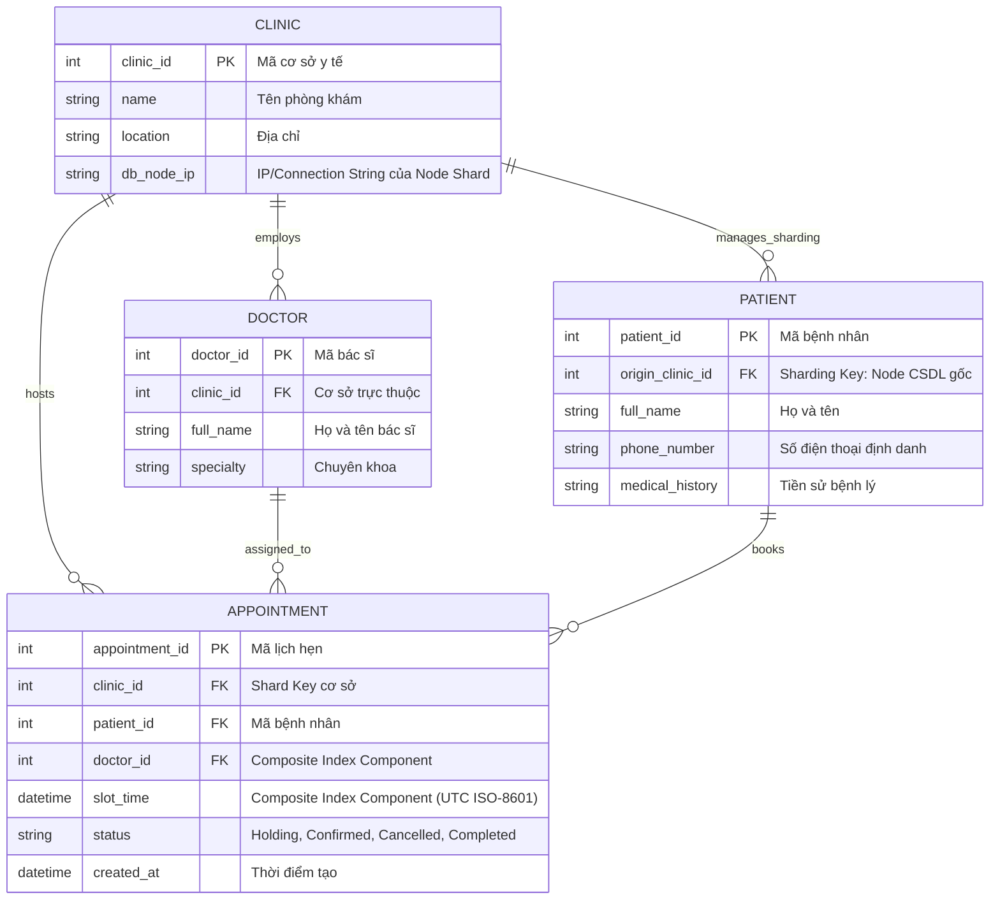
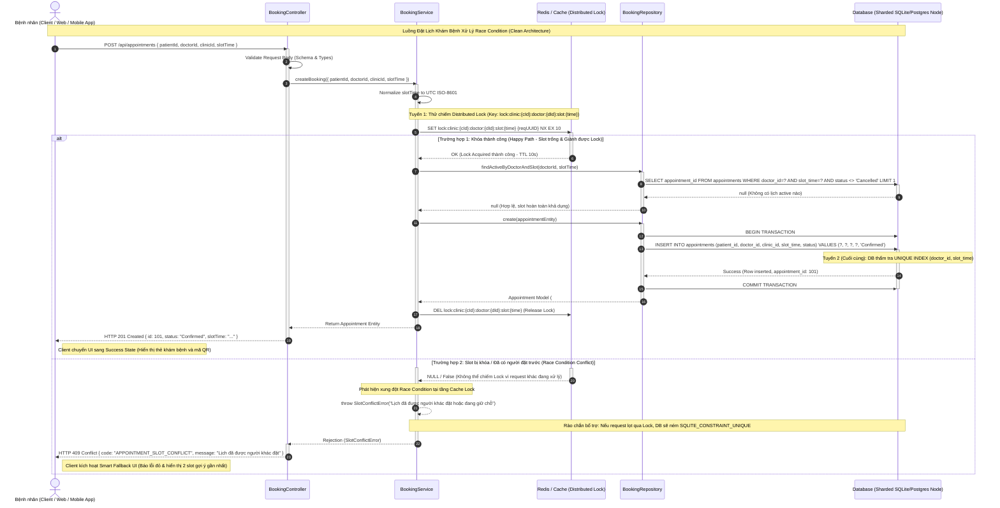

# Thiết kế Kiến trúc Kỹ thuật: Sơ đồ Tuần tự (Sequence Diagram) & Xử lý Race Condition trong Đặt lịch Khám

> **Dự án:** Hệ thống Quản lý Phòng khám Đa cơ sở (Distributed Clinic Management System)  
> **Căn cứ tài liệu:** `PRD.md` & `docs/auth/booking.md` (Phân tích Nghiệp vụ Chống Trùng lịch)  
> **Vai trò thực hiện:** Software Architect & Database Engineer (`/architect`)  
> **Tài liệu liên kết:** [booking.md](file:///c:/xampp1/htdocs/ClinicManagement/docs/auth/booking.md), [erd.mermaid](file:///c:/xampp1/htdocs/ClinicManagement/erd.mermaid), [sequence.mermaid](file:///c:/xampp1/htdocs/ClinicManagement/sequence.mermaid)

---

## 1. TỔNG QUAN KIẾN TRÚC HỆ THỐNG

### 1.1. Phân tích Yêu cầu Phi chức năng (Architectural Drivers)
* **Tính nhất quán dữ liệu (Strict Consistency - ACID):** Tuyệt đối không cho phép Double Booking ($0\%$ lỗi trùng lịch). Một slot thời gian $(T)$ của một Bác sĩ tại một Chi nhánh chỉ chấp nhận duy nhất một lịch hẹn có trạng thái hoạt động (`HOLDING` hoặc `CONFIRMED`).
* **Độ trễ thấp & Thông lượng cao (Low Latency & High Throughput):** Khung giờ mở bán slot khám hoặc khung giờ cao điểm có lưu lượng truy cập đột biến ($500 - 1000\text{ req/s}$). Yêu cầu thời gian phản hồi khóa slot $P95 < 150\text{ ms}$, $P99 < 300\text{ ms}$.
* **Khả năng mở rộng theo chiều ngang (Horizontal Scalability):** Hệ thống phân tán hỗ trợ nhiều cơ sở (Multi-clinic). Tải đặt lịch của Cơ sở Hà Nội không được gây ảnh hưởng đến hiệu năng đặt lịch của Cơ sở TP.HCM.

### 1.2. Mô hình Kiến trúc Đề xuất: Clean Architecture & 2-Layer Concurrency Defense
Hệ thống kết hợp mô hình phân tầng nghiêm ngặt **Clean Architecture** (`Controller -> Service -> Repository -> Model`) với **Chiến lược phòng thủ 2 lớp (Two-Layer Concurrency Defense)**:

```
[Client / App]
       │
       ▼ (HTTP REST)
[BookingController] (Validation & HTTP Mapping)
       │
       ▼ (DTO)
[BookingService] ──► [Redis Distributed Lock] (Tuyến 1: Fast-path Lock, In-Memory O(1))
       │
       ▼ (Entity)
[BookingRepository] ──► [Sharded Database Node] (Tuyến 2: ACID Transaction & Partial UNIQUE Index)
```

1. **Tuyến phòng thủ 1 (Fast-Path Lock - Redis Distributed Lock):**
   * Sử dụng Redis với lệnh nguyên tử `SET lock:clinic:{cId}:doctor:{dId}:slot:{time} {uuid} NX EX 10`.
   * Chặn đứng đến $95\%$ các request tranh chấp đồng thời ngay từ tầng Cache/In-memory, giải phóng áp lực I/O cho CSDL.
2. **Tuyến phòng thủ 2 (Ultimate Safety Net - Database Partial Unique Index):**
   * Rào chắn bất khả xâm phạm tại tầng lưu trữ:
     ```sql
     CREATE UNIQUE INDEX idx_unique_active_slot 
     ON appointments(doctor_id, slot_time) 
     WHERE status IN ('Holding', 'Confirmed');
     ```
   * Đảm bảo ngay cả khi Redis gặp sự cố, phân mảnh mạng (Network Partition), hoặc lock bị timeout ngoài ý muốn, Database Engine vẫn ném lỗi vi phạm ràng buộc duy nhất (`SQLITE_CONSTRAINT_UNIQUE` hoặc Postgres code `23505`), ngăn chặn tuyệt đối double-booking.

---

## 2. THIẾT KẾ CƠ SỞ DỮ LIỆU & MERMAID ERD

Hệ thống CSDL phân tán được thiết kế phân mảnh theo `clinic_id`. Bảng `APPOINTMENT` lưu giữ thông tin chi nhánh công tác, bác sĩ, bệnh nhân, thời gian và trạng thái vòng đời của lịch hẹn:



> **Ràng buộc chỉ mục duy nhất (Composite Partial Unique Index):**  
> `CREATE UNIQUE INDEX idx_unique_active_slot ON appointments(doctor_id, slot_time) WHERE status <> 'Cancelled';`

---

## 3. BIỂU ĐỒ TUẦN TỰ (MERMAID SEQUENCE DIAGRAM)

Biểu đồ mô tả chi tiết tương tác giữa 4 thành phần kiến trúc: **Client -> BookingController -> BookingService -> Database/Redis Lock**.

Bao gồm 2 trường hợp:
1. **Trường hợp 1 (Happy Path):** Khóa slot thành công, kiểm tra slot trống và tạo lịch hẹn (HTTP 201 Created).
2. **Trường hợp 2 (Conflict Path):** Slot đã bị khóa hoặc có người đặt trước, phát hiện xung đột và trả về HTTP 409 Conflict kèm Smart Fallback UI.



---

## 4. THIẾT KẾ PHÂN MẢNH SHARDING ĐA CƠ SỞ & CONCURRENCY CONTROL

### 4.1. Lựa chọn Shard Key & Định tuyến CSDL (Shard Key Selection & Routing)
* **Shard Key:** `clinic_id` được chọn làm Partition Key. Dữ liệu bệnh nhân và lịch hẹn phát sinh tại cơ sở nào sẽ được ghi trực tiếp vào Node CSDL của cơ sở đó.
* **Định danh Lock phân tán (Distributed Lock Key):**
  $$\text{Key} = \texttt{lock:clinic:\{clinic\_id\}:doctor:\{doctor\_id\}:slot:\{slot\_time\}}$$
  * Việc đưa `clinic_id` vào tiền tố Key đảm bảo không gian tên (Namespace) được phân tách hoàn toàn theo từng cơ sở, hỗ trợ dễ dàng khi scale Redis Cluster hoặc Redis theo từng vùng địa lý (Multi-region).

### 4.2. Mã nguồn Minh họa: Tích hợp Redis Lock vào Clean Architecture

#### 1. Module Helper Quản lý Khóa Phân tán (`src/config/redisLock.js`):
```javascript
const crypto = require('crypto');

class DistributedLock {
  constructor(redisClient) {
    this.redis = redisClient;
  }

  async acquire(resourceKey, ttlSeconds = 10) {
    const lockIdentifier = crypto.randomUUID();
    // SET resourceKey lockIdentifier NX EX ttlSeconds (Atomic operation)
    const result = await this.redis.set(resourceKey, lockIdentifier, 'NX', 'EX', ttlSeconds);
    return result === 'OK' ? lockIdentifier : null;
  }

  async release(resourceKey, lockIdentifier) {
    // Lua script giải phóng khóa an toàn (chỉ giải phóng nếu đúng identifier mình tạo)
    const luaScript = `
      if redis.call("get", KEYS[1]) == ARGV[1] then
        return redis.call("del", KEYS[1])
      else
        return 0
      end
    `;
    return this.redis.eval(luaScript, 1, resourceKey, lockIdentifier);
  }
}

module.exports = DistributedLock;
```

#### 2. Tầng Nghiệp vụ Chống Trùng Lịch (`src/services/appointmentService.js`):
```javascript
const { SlotConflictError } = require('./appointmentErrors');
const Appointment = require('../models/appointment');

class AppointmentService {
  constructor(repository, lockManager) {
    this.repository = repository;
    this.lock = lockManager;
  }

  async createBooking({ patientId, doctorId, clinicId, slotTime }) {
    const normalizedSlot = new Date(slotTime).toISOString();
    const lockKey = `lock:clinic:${clinicId}:doctor:${doctorId}:slot:${normalizedSlot}`;

    // 1. Thử chiếm Distributed Lock (Tuyến phòng thủ 1)
    const lockId = await this.lock.acquire(lockKey, 10);
    if (!lockId) {
      // Bị chiếm trước bởi request khác trong cùng mili-giây -> Lập tức ném 409
      throw new SlotConflictError('Khung giờ này đang có người giữ chỗ hoặc xử lý');
    }

    try {
      // 2. Kiểm tra nghiệp vụ trong CSDL
      const existing = await this.repository.findActiveByDoctorAndSlot(doctorId, normalizedSlot);
      if (existing) {
        throw new SlotConflictError('Lịch đã được người khác đặt');
      }

      // 3. Ghi vào CSDL trong Transaction (Tuyến phòng thủ 2: Unique Index)
      return await this.repository.create(new Appointment({
        patient_id: patientId,
        doctor_id: doctorId,
        clinic_id: clinicId,
        slot_time: normalizedSlot,
        status: 'Confirmed'
      }));
    } catch (error) {
      if (error.code === 'SQLITE_CONSTRAINT_UNIQUE' || error.code === '23505') {
        throw new SlotConflictError('Lịch đã được người khác đặt');
      }
      throw error;
    } finally {
      // 4. Luôn giải phóng lock trong block finally
      await this.lock.release(lockKey, lockId);
    }
  }
}

module.exports = AppointmentService;
```

---

## 5. MA TRẬN ĐÁNH GIÁ 2 TRƯỜNG HỢP XỬ LÝ (COMPARISON MATRIX)

| Tiêu chí | Trường hợp 1: Thành công (201 Created) | Trường hợp 2: Xung đột (409 Conflict) |
| :--- | :--- | :--- |
| **Phản hồi Redis Lock** | `OK` (Cấp khóa thành công trong 10 giây). | `NULL / False` (Không thể chiếm khóa vì bị chiếm trước). |
| **Hành vi Tầng Service** | Kiểm tra slot trống, gọi Repository mở Transaction `INSERT`. | Ném ngay `SlotConflictError` từ tầng Lock mà không chạm DB. |
| **Hành vi Tầng Database** | Ghi nhận bản ghi hợp lệ, commit dữ liệu, trả về ID mới. | Hoàn toàn không chịu tải I/O (hoặc bị chặn bởi `UNIQUE INDEX`). |
| **HTTP Response** | `201 Created` kèm payload đối tượng Appointment. | `409 Conflict` kèm mã lỗi chuẩn `APPOINTMENT_SLOT_CONFLICT`. |
| **Phản ứng Frontend** | Tắt Spinner, hiển thị thẻ khám xác nhận thành công và mã QR. | Kích hoạt Fallback UI, hiển thị Toast cảnh báo và gợi ý 2 khung giờ liền kề. |

